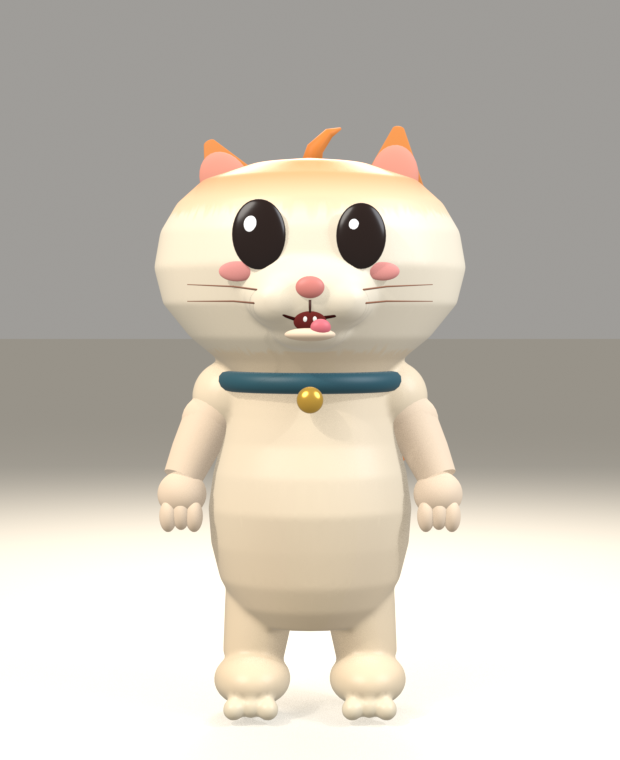

# 阿拉斯加 · AI Token 桌面宠物

一个跑在 Windows 桌面上的 3D 抽象小猫桌宠：透明窗口、可拖动、可调大小，会呼吸、看左右、伸懒腰、打哈欠、洗脸，也会吃冰激凌和饭。

> 当前是本地原型版，还没有发布安装包；先在源码目录运行。



## 它现在能做什么

- **3D 真建模**：Blender 建模 + 骨骼 + 9 个动作，不是贴图拼四肢。
- **透明桌宠**：无边框、透明背景、始终置顶；透明区域不挡桌面点击。
- **拖动与大小**：小 / 中 / 大三档；拖动时只改位置，不改窗口尺寸。
- **待机动作**：呼吸、东张西望、晃身、伸懒腰、打哈欠、洗脸。
- **互动**：单击会眯眼、跳一下，并随机说一句话；双击打开钱包 / 对话面板。
- **吃东西**：冰激凌、小饼干、西瓜、水果米饭；有下颌开合、口腔、舌头、咬合、食物缩小和碎屑。
- **token 钱包**：从本机 Codex / CSG 会话日志读取 token 和估算花费。
- **AI 对话**：面板里可以直接聊天；支持 OpenAI 兼容接口，也可以用本机 Ollama 兜底。

## 快速开始

```powershell
# 1. 安装依赖
npm install

# 2. 启动
npm start
```

也可以双击 `启动阿拉斯加.cmd`。

## 配置 AI

复制 `.env.example` 为 `.env`：

```powershell
Copy-Item .env.example .env
```

填入任意 OpenAI 兼容服务：

```ini
LLM_API_URL=https://api.openai.com/v1/chat/completions
LLM_API_KEY=sk-your-key
LLM_MODEL=gpt-4o-mini
```

也支持 OpenCSG AI Gateway 这类兼容网关：

```ini
LLM_API_URL=https://openeast.opencsg.com/aigateway/v1/chat/completions
LLM_API_KEY=sk-your-key
LLM_MODEL=glm-5.2
```

也可以不填远程配置，直接启动本机 Ollama：

```powershell
ollama serve
ollama pull llama3.2
```

`.env` 已在 `.gitignore` 中，不要提交真实 Key。

### 已验证

- OpenCSG `POST /aigateway/v1/chat/completions` + `glm-5.2` 返回 200，`finish_reason=stop`，能正常出中文回答。
- GLM / DeepSeek 会先花 token 在 `reasoning`；`max_tokens` 低于 800 时 `message.content` 可能为空，所以默认预算为 1200。
- 网关的思考字段是 `message.reasoning`，不是 `reasoning_content`；界面只显示 `message.content`。

## 检查与测试

```powershell
npm run check   # JS 语法检查
npm test        # GLB 动画/骨骼结构 + 仓库必要文件
```

## 目录

```text
main.js                 Electron 主进程：窗口、托盘、拖拽、AI 请求
preload.js              IPC 白名单
usage.js                读取本机 token 会话
app/                    桌宠与面板页面、Three.js 资源
model/build_cat.py      Blender 建模、骨骼、动作、GLB 导出
app/assets/lulu.glb     当前模型
test/                   GLB 与仓库结构检查
ARCHITECTURE.md         运行结构、模型管线、AI 请求、隐私边界
PROJECT_ROADMAP.md      建模 / 功能 / AI / 开源盘点
```

## 模型与动作

当前 GLB 包含 9 个 clip：

- `Idle_Breathe`
- `Idle_Look`
- `Idle_Wiggle`
- `Idle_Stretch`
- `Idle_Yawn`
- `Idle_Groom`
- `Touch_Happy`
- `Eat_IceCream`
- `Eat_Meal`

重建模型：

```powershell
tools\blender-4.5.16-windows-x64\blender.exe --background --python model\build_cat.py
```

## 已知限制

- 口腔还是简化结构：有下颌、口腔、舌头和两颗小牙，但没有完整牙齿、上颚和食物咬缺口网格。
- 前爪可以抬到脸侧，但还不能真正抓住甜筒/碗边；食物是送到嘴边的。
- 没有表情 blendshapes，眨眼和鼓腮主要靠骨骼缩放。
- AI 对话目前是单轮请求 + 最近 12 条上下文，没有流式输出和长期记忆。
- 还没有安装包、自动更新、代码签名和多显示器回归。

更完整的缺口和下一步见 [PROJECT_ROADMAP.md](PROJECT_ROADMAP.md)。

## 隐私

- token 数据来自本机日志，不上传。
- AI 对话只在点击发送时请求所配置的模型；使用 Ollama 时不出本机。
- API Key 只从 `.env` 或环境变量读取，不写入页面和日志。

## License

- 代码：MIT，见 [LICENSE](LICENSE)。
- 第三方依赖：见 [NOTICE](NOTICE)。
- 模型与动作资产：当前仓库保留所有权利；正式发布前计划单独采用 CC BY 4.0 或 CC0。
